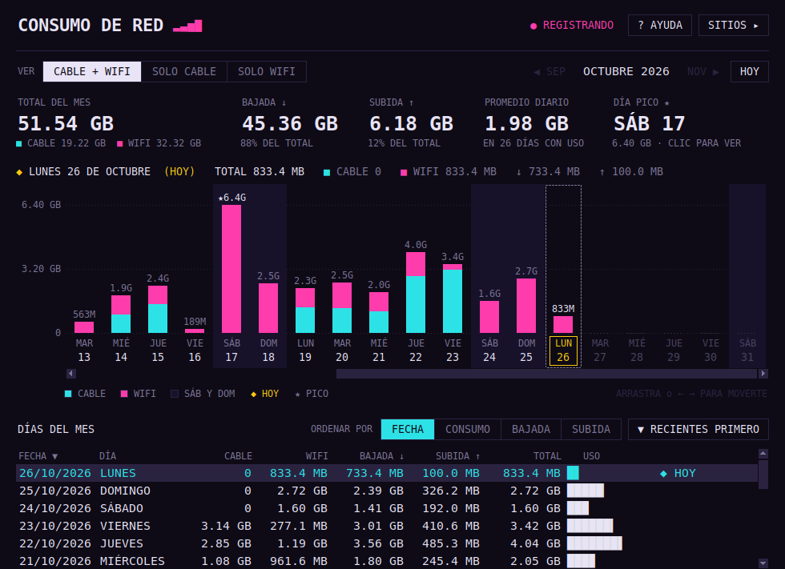
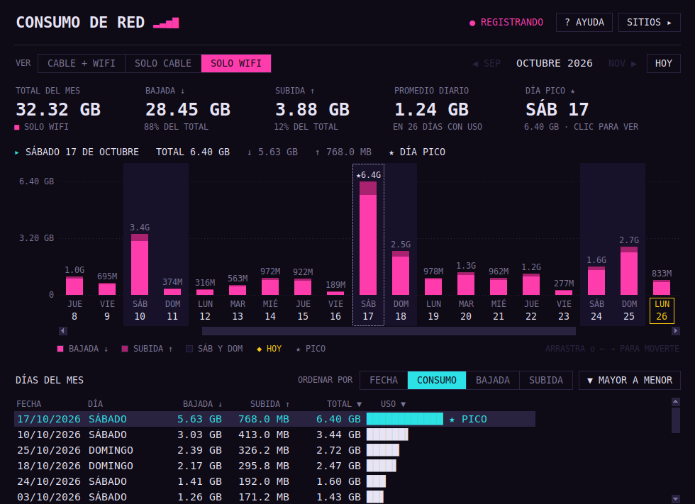
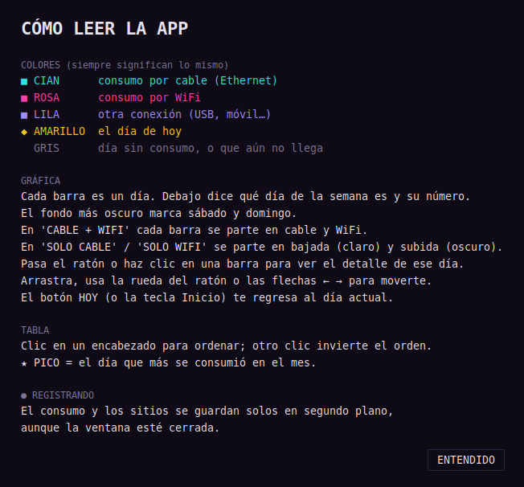
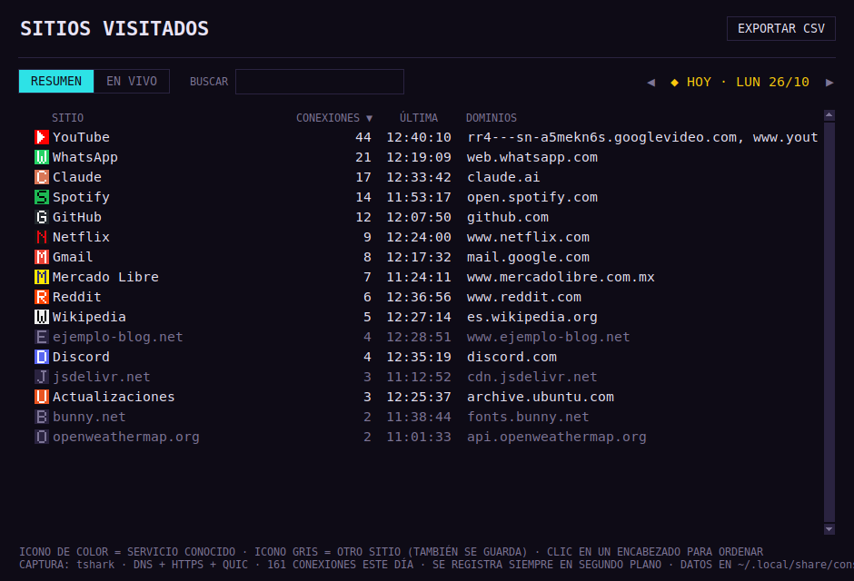
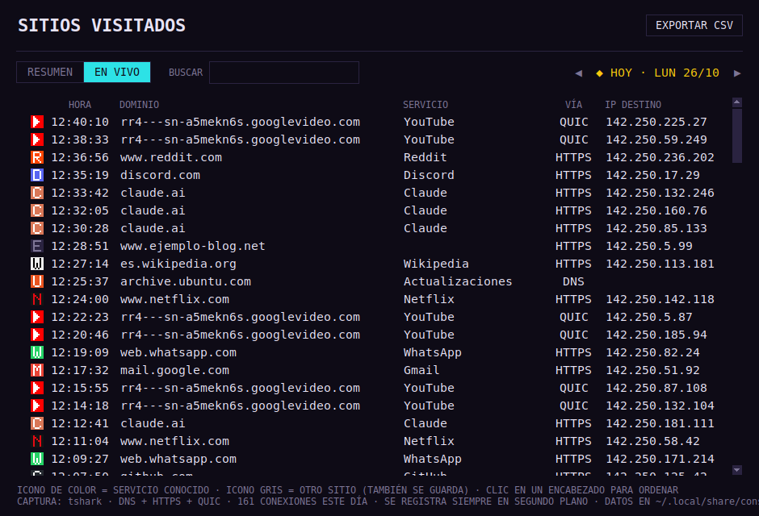

# Consumo de Red

Monitor de escritorio, con estilo ochentero y minimalista, que te dice **cuántos datos consumes cada día**,
**separado por cable y WiFi**, y **a qué sitios se conecta tu computadora**. Funciona en **Linux** y **Windows**.

Todo se registra solo y en segundo plano, aunque la ventana esté cerrada. Los datos se quedan en tu
computadora y no se envían a ningún lado.



---

## Características

- **Consumo por día** en una gráfica que se desplaza y abre centrada en hoy, con los días
  anteriores a la izquierda y los siguientes a la derecha. Cada barra dice qué día de la semana es.
- **Cable, WiFi o ambos**: con los botones `CABLE + WIFI`, `SOLO CABLE` y `SOLO WIFI` ves las
  dos conexiones juntas o cada una por separado.
- **Navegación por meses** con `◀` / `▶`, y botón `HOY` para regresar al día actual.
- **Tabla ordenable** por fecha, día de la semana o consumo (total, bajada o subida), de mayor
  a menor o al revés.
- **Sitios visitados** con iconos pixelados para unos 35 servicios conocidos (YouTube, Netflix,
  Spotify, WhatsApp, Claude, GitHub, Mercado Libre…). Los demás sitios también se guardan, con un
  icono gris.
- **Registro automático**: arranca al iniciar sesión, sin pulsar ningún botón.
- **Exportar a CSV** el resumen de sitios de cualquier día.
- **Reporte ejecutivo por horario** (`REPORTE ▸`): eliges fechas (con calendario), horario en
  formato AM/PM (por ejemplo 9:00 AM a 4:00 PM, o un turno nocturno 10:00 PM a 6:00 AM), días de
  la semana y conexión (cable, WiFi o ambos). Genera una página lista para imprimir o guardar como
  PDF (Ctrl+P) con indicadores, consumo por día y por hora, y los sitios/DNS de ese horario.
  Los sitios se pueden agrupar (cada dominio, por sitio o por servicio), mostrar todos o solo los
  más comunes, y quitar o poner los que quieras en el reporte; lo que quitas se recuerda para el
  siguiente. El detalle por hora se registra desde que instalas esta versión.
- Si tienes **vnstat** (Linux), también muestra el historial de antes de instalar la app.

## Capturas

| Solo WiFi, ordenado por consumo | Ayuda integrada |
|---|---|
|  |  |

| Sitios visitados: resumen | Sitios visitados: en vivo |
|---|---|
|  |  |

> Las capturas usan datos de demostración.

---

## Instalación

### 🐧 Linux (Ubuntu, Debian, Mint, Fedora, Arch…)

```bash
git clone https://github.com/Horurasu/operator-net-monitor.git
cd operator-net-monitor
chmod +x instalar.sh
./instalar.sh
```

El instalador pide tu contraseña (`sudo`) y hace esto:

1. Instala lo que falte: `python3-tk` y `tshark`. Usa `apt`, `dnf` o `pacman`, según tu distro.
2. Te da permiso para capturar tráfico: te agrega al grupo `wireshark`.
3. Copia la app a `~/.local/share/consumo-red/`.
4. Crea el acceso **"Consumo de Red"** en el menú de aplicaciones y en el escritorio.
5. Configura el registro para que arranque solo al iniciar sesión, y lo arranca de una vez.

> **Importante:** la primera vez, **cierra sesión y vuelve a entrar** (o reinicia) para que se
> aplique el permiso de captura. Sin eso, el consumo sí se registra, pero los sitios visitados no.

Para actualizar, haz `git pull` y vuelve a correr `./instalar.sh`. Tus datos no se pierden.

### 🪟 Windows 10 / 11

1. Instala **Python 3** desde [python.org](https://www.python.org/downloads/).
   En el instalador marca **"Add python.exe to PATH"**. Tkinter ya viene incluido.
2. Descarga este repositorio: **Code → Download ZIP** y descomprímelo, o usa `git clone`.
3. Haz **doble clic en `instalar_windows.bat`**.

El instalador no necesita permisos de administrador y hace esto:

1. Instala `psutil` con `pip`, para leer el consumo de cada adaptador de red.
2. Copia la app a `%LOCALAPPDATA%\ConsumoRed\`.
3. Crea el acceso **"Consumo de Red"** en el menú Inicio y en el escritorio.
4. Agrega el registro a la carpeta **Inicio** de Windows para que arranque solo, y lo arranca de una vez.

> En Windows, los sitios se leen de la **caché DNS del sistema**, así que no hay que instalar
> Wireshark. Es un poco menos preciso que en Linux: si vuelves a un sitio mientras sigue en la
> caché, no se cuenta como una visita nueva.

### Sin instalar (cualquier sistema)

Si solo quieres probarla, la puedes correr directo:

```bash
python3 consumo_red.py              # abre la ventana (y arranca el registro si no está corriendo)
python3 consumo_red.py --registrar  # solo el registro, sin ventana
```

En Windows usa `py` en lugar de `python3`.

### Requisitos

| | Linux | Windows |
|---|---|---|
| Python | 3.8 o más reciente, con `tkinter` | 3.8 o más reciente (de python.org) |
| Consumo por interfaz | `/proc/net/dev` (incluido) o `psutil` | `psutil` (lo instala el instalador) |
| Sitios visitados | `tshark` (lo instala el instalador) | Caché DNS de Windows (incluida) |
| Historial previo (opcional) | `vnstat` | — |

macOS no está soportado por ahora.

---

## Cómo se usa

| Elemento | Qué hace |
|---|---|
| `CABLE + WIFI` / `SOLO CABLE` / `SOLO WIFI` | Elige qué conexión ver. |
| `◀ SEP` · `NOV ▶` | Cambia de mes. |
| `HOY` (o la tecla **Inicio**) | Regresa al día actual. |
| Barras de la gráfica | Pasa el ratón o haz clic en una para ver el detalle de ese día. |
| Arrastrar, rueda del ratón, **← →** | Te mueven por los días del mes. |
| `ORDENAR POR` o clic en un encabezado | Ordena la tabla; otro clic invierte el orden. |
| `DÍA PICO ★` | Clic para saltar al día de mayor consumo. |
| `SITIOS ▸` | Abre la ventana de sitios visitados. |
| `? AYUDA` | Explica todos los colores y controles. |
| `● REGISTRANDO` | Indica que el registro en segundo plano está activo. |

### Qué significa cada color

| Color | Significado |
|---|---|
| 🟦 Cian | Consumo por **cable** (Ethernet) |
| 🟪 Rosa | Consumo por **WiFi** |
| 🟣 Lila | Otra conexión (USB, módem móvil…) |
| 🟨 Amarillo | El día de **hoy** |
| ⬜ Gris | Día sin consumo, o que todavía no llega |

En la vista `SOLO CABLE` o `SOLO WIFI`, cada barra se divide en **bajada** (tono claro) y
**subida** (tono oscuro).

---

## Cómo funciona

```
┌──────────────────────────┐      escribe      ┌──────────────────┐      lee      ┌──────────┐
│ consumo_red.py           │ ────────────────▶ │  consumo.db      │ ◀──────────── │ ventana  │
│   --registrar            │                   │  (SQLite local)  │               │ (Tkinter)│
│ · contadores cada 10 s   │                   └──────────────────┘               └──────────┘
│ · sitios: tshark / DNS   │
└──────────────────────────┘
```

- El **registrador** corre en segundo plano. Suma los bytes de cada interfaz por día y anota cada
  dominio al que se conecta la máquina: consultas DNS y el nombre del servidor en HTTPS/QUIC
  (SNI), lo mismo que vería tu módem. Solo puede correr uno a la vez.
- La **ventana** solo lee la base de datos y se actualiza sola cada 30 segundos.
- Las interfaces virtuales (Docker, VPN, VirtualBox, loopback…) no se cuentan.

**Dónde se guardan los datos**

| Sistema | Ruta |
|---|---|
| Linux | `~/.local/share/consumo-red/consumo.db` |
| Windows | `%LOCALAPPDATA%\ConsumoRed\consumo.db` |

> **Privacidad:** solo se guardan nombres de dominio, horas e IPs de destino. Nunca el contenido
> de las páginas, ni contraseñas, ni direcciones completas. Nada sale de tu computadora.

---

## Solución de problemas

| Problema | Solución |
|---|---|
| Dice `○ SIN REGISTRO` | Abre la app: el registro arranca solo. Si sigue igual, corre `python3 consumo_red.py --registrar` en una terminal para ver el error. |
| Linux: "Sin permiso para capturar" en Sitios | Cierra sesión y vuelve a entrar después de instalar. Si sigue igual, corre `./instalar.sh` de nuevo. |
| Linux: "Falta tshark" | `sudo apt install tshark` (o vuelve a correr `./instalar.sh`). |
| Windows: el `.bat` dice que falta Python | Reinstala Python marcando **"Add python.exe to PATH"**. |
| Una interfaz aparece como "otra" | Es una interfaz física que no es ni cable ni WiFi (por ejemplo, un módem USB). Se suma en `CABLE + WIFI`. |

---

## Desinstalar

**Linux**

```bash
pkill -f "consumo_red.py --registrar"
rm -f ~/.local/share/applications/consumo-red.desktop \
      ~/.config/autostart/consumo-red-registro.desktop \
      "$(xdg-user-dir DESKTOP)/consumo-red.desktop"
rm -rf ~/.local/share/consumo-red      # ⚠ borra también tu historial
```

**Windows** (en PowerShell)

```powershell
Get-CimInstance Win32_Process -Filter "Name LIKE 'python%'" |
  Where-Object { $_.CommandLine -like "*consumo_red.py*--registrar*" } |
  ForEach-Object { Stop-Process -Id $_.ProcessId -Force }
Remove-Item "$([Environment]::GetFolderPath('Startup'))\Consumo de Red (registro).lnk",
            "$([Environment]::GetFolderPath('Programs'))\Consumo de Red.lnk",
            "$([Environment]::GetFolderPath('Desktop'))\Consumo de Red.lnk" -ErrorAction SilentlyContinue
Remove-Item -Recurse "$env:LOCALAPPDATA\ConsumoRed"   # ⚠ borra también tu historial
```

---

## Estructura del proyecto

```
consumo_red.py          La app completa: registrador + ventana
instalar.sh             Instalador para Linux
instalar_windows.bat    Instalador para Windows (doble clic)
instalar_windows.ps1    Lo que ejecuta el .bat
docs/img/               Capturas del README
```
